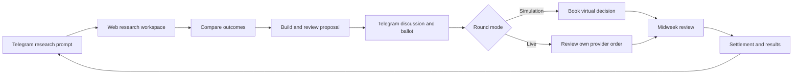
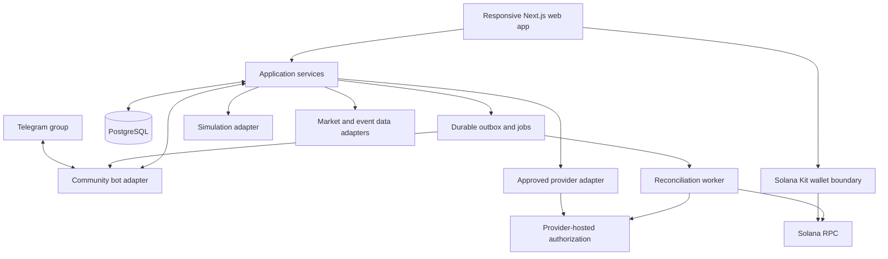

# Guild Wars Solana MVP Design Specification

**Status:** Draft for product and engineering review. No production implementation or provider approval is implied.

**Version:** 0.3 · **Date:** November 7, 2026

Guild Wars helps groups make, challenge, and review covered-call decisions together. Members research and build proposals in a responsive web app, then discuss and vote in their existing Telegram group. The MVP supports both simulated trading and individually authorized real trading. A covered call exchanges some upside for an option premium; the underlying SOL can still lose substantial value.

The recommended implementation uses Solana Kit for Solana interactions, a regular Telegram community bot, and one shared application backend. One existing options provider handles live execution and settlement. Guild Wars does not build an options protocol or hold a guild treasury in the MVP.

## 1. Product decisions

### Agreed scope

| Area | MVP decision |
| --- | --- |
| Core strategy | Yield Defender: own SOL and decide whether to sell a covered call or keep holding. |
| Interfaces | Responsive desktop and mobile web app, plus a regular Telegram community bot. No Telegram Mini App. |
| Chain integration | Solana only. No EVM integration, bridges, or multichain wallet routing. |
| Trade underlying | SOL only. USDC may be used for premium, cash balances, and settlement under approved provider terms. Wrapped SOL is a technical representation where required; no liquid-staking tokens or other underlying assets. |
| Trading modes | Simulation and real trading are both product requirements. Neither is described as a prerequisite for the other. |
| Accounts | Members authorize their own trades. No captain can trade another member's funds. |
| Group decisions | Up to two eligible covered-call proposals plus Keep holding, voted on inside Telegram. |
| Weekly loop | Research, proposals, opening ballot, individual execution or simulation booking, one midweek response round, expiration and review. |
| Pilot season | Four weekly rounds; target 5–20 members per guild. These are proposed pilot settings. |
| House | A disclosed, rule-based paper opponent locked before opening decisions. An AI explanation can accompany its deterministic plan. |
| Community rewards | Separate learning XP, research reputation, and competitive season points. No token at launch. |

### Proposed execution decision for review

**Recommendation: provider-first SOL options.** Prefer a suitable Solana-native provider, but permit a suitable provider to execute SOL options off-chain if that is the best validated route to a live MVP. Guild Wars' own wallet and blockchain integration remains Solana-only.

This is narrower than a multichain app but is **not** a promise that every live option settles on Solana. Each live product must disclose its execution venue, custody model, settlement location, and withdrawal conditions. An off-chain provider position cannot be displayed as an on-chain Solana position merely because its owner linked a Solana wallet.

Off-chain execution is a proposed product decision for review. It does not authorize another-chain DeFi integration through an intermediary. Provider selection and any live release require their own validation.

Live launch requires one validated provider. If no provider meets the requirements, the live feature is not ready: a simulation deployment is not represented as completion of the dual-mode MVP. Do not silently substitute another chain, unverified trade imports, or an internally built derivatives venue.

## 2. Why members participate

The guild provides a structured investment discussion: inspect the same trade, bring competing evidence, compare downside and capped-upside outcomes, and review the result against holding. The record shows whether a decision helped, including when the useful decision was to keep holding or challenge a popular plan.

Members are not promised better premiums because they joined a guild. The pilot measures quote availability, execution costs, research usefulness, return participation, and outcomes after costs. Group requests for quotes or negotiated fee benefits are later experiments supported by observed demand.

A beginner should be able to answer four questions before participating: What crypto is covered? At what price could it be sold? When does the obligation end? What happens if the crypto rises or falls?

## 3. Scope boundaries

The MVP includes guild membership and roles; Telegram account linking; weekly research; simple comparisons and scenarios; versioned proposals; Telegram ballots; two execution adapters; individual positions; provider-supported midweek actions; settlement records; comparisons with holding and the House; a small research-reputation pilot; and operational controls.

Deferred: provider-managed pooled guilds, fractional interests in pooled capital, a new options smart contract, custom escrow, automatic copy trading, autonomous AI execution, live buyer-versus-seller matching, staggered portfolios, multiple expirations within a round, the Wheel strategy, and token issuance. These remain possible extensions; they do not become mandatory fields or controls in the beginner flow.

Broader stock, crypto, and macro research is welcome. Solana-only trading does not prohibit discussing a stock earnings event or registering a stock forecast for research recognition. Such research does not add stock execution to this MVP.

## 4. Member journey and screen requirements

### Onboarding

An invitation opens the correct guild and explains covered calls before presenting a joining action. Connect Telegram through a short-lived bot linking flow. Joining a simulation guild does not require a wallet, deposit, token, or trade. A live member completes risk acknowledgement and provider eligibility checks before live execution. Members may participate in research and discussion without placing a live order.

The wallet link is separate from Telegram identity and separate again from provider account authorization. Display a persistent Simulation or Live badge on rounds, positions, ballots, and results. A guild selects one trading mode for a season; changing it creates a new season and does not reinterpret old records. One person may join different guilds, but only one guild per competitive division per season is eligible for scoring.

### Research workspace

The first app screen for a round presents one decision: sell a covered call against SOL or keep holding. It contains:

1. SOL reference price with source, observation time, currency, and data status.
2. Relevant events with original-source links, scheduled times, last-checked timestamps, and uncertainty.
3. At most two or three available strike choices during research; the final ballot includes at most two proposals. Show exact expiration, gross premium, all known fees, net premium, size requirements, liquidity or quote availability, and settlement type.
4. Falling, flat, and rally scenarios for the whole covered position versus holding. Use a fixed 1 SOL reference for plan comparison, subject to clear treatment of provider minimum sizes.
5. Sourced guild notes, an opposing view, and unresolved questions.

Display ordinary language first: agreed sale price, premium received, and expiration. Explain strike, exercise, and settlement inline. Greeks and volatility assumptions are optional detail. A spot feed does not supply option premiums. Missing or stale quotes remain visibly unavailable; they are never replaced by invented executable prices.

### Research tools and integrations

The beginner workspace follows three steps: Understand the market, Compare the calls, and Add your evidence. Every member can use the core tools, contribute research, and challenge a proposal. No specialist title, XP threshold, or reputation rank unlocks the information used in official guild decisions.

| Tool | Member decision it supports | Proposed integration and scope |
| --- | --- | --- |
| Executable call comparison | How much net premium would I receive, what upside would I give up, and can I actually trade these terms? | The selected options provider is authoritative for available contracts, bid/ask or executable quotes, supported size, fees, expiry, settlement, and management capabilities. This integration is required for live trading. |
| SOL price and history | How has SOL moved, and how far is the proposed strike from the current price? | Start with one licensed market-data integration, CoinGecko, for SOL reference prices and history. Its market-chart endpoint provides timestamped prices and volume [R1]. Provider quotes still use their own reference and settlement terms. |
| Readable price chart | Where do the proposed strikes sit relative to the recent price? | TradingView Lightweight Charts, fed with our permitted data, with strike lines and an expiration marker. This is a charting library, not a bundled price feed or option-quote service. Preserve its required attribution [R2]. |
| Covered call versus holding calculator | What happens in a selloff, a small move, or a strong rally? | Build deterministic, instrument-specific payoff calculations in the shared domain module. Show net premium, capped upside, total P&L, and the holding comparison. A separate interactive payoff plot and accessible numeric table accompany the price chart. No external analytics subscription is needed for this calculation. |
| Events before expiration | Could a known announcement or operational incident change my willingness to cap upside? | A small curated calendar links to Federal Reserve and BLS releases, original ecosystem announcements, and Solana Status updates. Solana Status offers RSS/Atom; macro dates start as checked calendar entries, not an assumed public calendar API [R3]. |
| Shared evidence and counterarguments | What supports this plan, and what is the strongest reason against it? | Our own research records and Telegram integration. Members attach a source, short claim, relevant time horizon, disclosures, and optional counterargument to the exact proposal version. |
| Optional explanation assistant | What does this term mean, or what are the competing views? | Later or feature-flagged: source-linked summaries and beginner explanations based on approved data and submitted evidence. It must distinguish facts, forecasts, and uncertainty, retain access controls, and never invent quotes, probabilities, or trade permissions. |

Keep the front page to the current SOL setup, two or three call comparisons, a simple outcome view, relevant events, and the guild's evidence. Do not require a technical-analysis terminal or an options-chain grid before a member can understand a proposal.

**Advanced detail, not a beginner prerequisite:** show provider-supplied implied volatility and Greeks when the actual product supports them and the data is licensed. Historical realized volatility can be computed from the approved price series using a disclosed lookback, sampling interval, missing-data rule, and annualization convention. Do not compare mismatched periods or present volatility as a price forecast. A model-derived delta is not a guaranteed probability of assignment. If the required data is missing, omit the metric rather than filling it with an unexplained estimate.

**Add only when justified:** Pyth is a candidate for independent, timestamped reference prices or a provider-required oracle integration; its API documents real-time, historical, and Hermes-compatible access [R4]. Confirm the feed, access plan, and data rights before selection. A broad market price cannot replace the contract's specified settlement feed, time window, or exercise rule. CoinGecko and Pyth do not substitute for executable option quotes.

Helius is an optional Solana transaction-data integration if an on-chain provider path needs event monitoring or easier reconciliation. Its current documentation recommends Parsed Streams for new parsed-transaction integrations [R5]. This is execution infrastructure, not evidence that a covered-call thesis is sound; it is not required merely to render the research workspace. A provider's off-chain positions require its own records.

Do not add a paid news aggregator, whale-tracking suite, social-sentiment score, external options analytics terminal, or equities data subscription to the core MVP by default. Broader crypto, stock, and macro research can start with source-linked member contributions. Add paid coverage after observing a specific recurring research need and verifying redistribution rights.

**Data controls:** fetch credentials and paid data server-side, cache within the permitted terms, and record source, instrument, observation time, ingestion time, units, freshness, and quote class. Display whether a number is executable, indicative, historical, simulated, or model-derived. Research chart data is not automatically licensed or sufficiently granular for ranked fills and hourly valuation. A data failure must not silently switch official settlement or scoring sources.

These are recommended integration choices for implementation planning, not claims that accounts, subscriptions, data licences, or provider access have already been obtained.

### Outcome comparison

For a simple physically delivered call held to expiration, the teaching calculator uses:

`covered result = quantity × (min(expiration price, strike) − starting price) + premium − fees`

`holding result = quantity × (expiration price − starting price)`

The call terms must match this simplified model. The calculator is not used to value a cash-settled or differently collateralized product without its correct payoff adapter. Taxes, provider failure, stablecoin depegs, and transaction failures are not implied to be captured by this formula. No scenario is presented as a probability or expected profit.

### Plan builder and brief

The form asks for reference holding, shared expiration, strike, covered proportion, why the plan makes sense, main risk, evidence, and what would change the author's view. The ranked core proposal uses 100% of the round's reference SOL allocation; partial coverage is an unranked personal deviation during the pilot. Provider minimums do not imply permission to fractionalize a contract.

Before sharing, show the exact brief, outcome summary, indicative quote timestamp, fee assumptions, and an explicit Publish to Telegram action. Publication creates a backend record and a bot-delivery job. Users see Pending delivery, Published, or Failed; no success toast appears until a Telegram message reference is saved.

### Telegram discussion and voting

The group receives a compact plan card with its guild, round, proposal version, terms, reasoning, risk, and direct web links. The web page includes a return link to that message. Selected evidence is attached to the proposal by explicit bot commands or replies; the MVP does not mirror the entire chat into the app.

The final ballot has one or two proposal choices and Keep holding. A member can understand the key tradeoffs from the message without a compulsory web visit. A research link opens the same version used by the ballot.

### Individual trade review

After a live ballot closes, Review my trade opens the selected plan in the app. The member chooses their own quantity, requests a fresh provider quote or opens the approved provider review, checks full costs and settlement terms, and separately authorizes. Refusing, cancelling, or failing an order does not remove their research participation or ballot history.

Where exact provider order prefill is supported, pass a signed or server-validated plan reference. Otherwise show a clear manual provider handoff with the exact terms to select. Do not scrape undocumented interfaces or imply a deep-link feature exists before it is verified.

### Midweek and results

Telegram posts one scheduled response ballot with a link to updated research. Hold remains a complete response. Other actions appear only when the approved provider and product support them. The app shows buyback costs and revised obligations for buying to close, rolling up or out, buying a call, or adding a hedge. They require separate member authorization. A locked product may offer only Hold and thesis reassessment.

Results distinguish scheduled expiration, observed settlement, claimable proceeds, and completed withdrawal. Display the whole result after known costs, the holding comparison, the paper House, contribution recognition, and any unresolved or estimated values.

## 5. Guild and ballot rules

### Roles and permissions

| Role | Permission |
| --- | --- |
| Member | Research, contribute evidence, question assumptions, discuss risks, submit or challenge proposals, vote when eligible, and manage own trades. All members have equal access to the core research tools. |
| Captain | Coordinate the round and nominate the final candidate set before lock. Cannot override votes or move funds. |
| Guild administrator | Manage membership and the Telegram binding, with an audit trail. Cannot rewrite a closed ballot. |
| Platform operator | Manage provider eligibility, incidents, disputes, and feature flags. Corrections are recorded as new events. |

Research and risk discussion are shared member activities, not a separate guild role or permission tier. Members need no appointment, reputation threshold, or captain approval to contribute evidence, ask a beginner question, or challenge a plan. Roles may overlap. Any conflict-free members may take part in the separate, rotating bounty and award review process; that assignment confers no authority over trading research or the guild vote.

### Proposed pilot settings

- Research and proposal collection: at least 24 hours before candidate lock.
- Opening ballot: 12 hours; exact times and provider expiration shown before voting.
- Execution window: one published window after closing, no longer than 60 minutes in the pilot. The approved provider must be able to support the window.
- Midweek response ballot: one 12-hour window during the contract's term.
- Eligibility: accepted guild member with a linked Telegram account before the opening ballot's roster snapshot. Departed or suspended members cannot cast or change votes; already valid votes remain in the history and tally unless a documented fraud correction applies.
- Quorum: a strict majority of the frozen eligible roster, `floor(N / 2) + 1`.
- Winner: the unique choice with the most valid votes once quorum is met. A tie, missing candidates, missing quorum, or invalid round yields Keep holding. Abstention is not counted as a vote.
- During voting, publish participation counts and the member's own receipt. Reveal choice totals after closing.
- One current vote per member per ballot, changeable until the server deadline. Capital, tokens, XP, and roles do not increase weight.

A bot callback acknowledgement is not proof of a saved vote. Confirm success only after the transaction commits. Concurrent changes use a monotonic vote revision; duplicate Telegram updates cannot add a second vote. The server clock decides whether a vote is timely.

### Versioning and publication

A proposal is editable while a draft. Sharing records a version. Ballot opening locks exact proposal versions, the roster, choices, timetable, quote acceptance limits, and fallback. A material change to strike, covered proportion, expiration, settlement, provider, fees or acceptance limits requires a new version and ballot. Correcting a typo adds a visible annotation without altering terms.

Cancellation produces a reason and a new ballot identifier if reissued. Old buttons return Closed or Superseded. A delayed bot edit never reopens voting. Member-facing state comes from the backend, not the visual state of a Telegram message.

## 6. Telegram and web connection

Each binding records `guild_id`, Telegram `chat_id`, optional topic identifier, and the administrator who verified it. The person authorizing a binding must control the relevant guild account and be a verified administrator in the selected Telegram group. Use least privilege for the bot. Membership verification may require administrator permissions; if granted, Telegram can deliver broader messages even with privacy mode configured. In that case the application still retains and processes only selected commands, proposal replies, and necessary membership events by default.

The primary account link uses a server-issued, single-use, five-minute nonce bound to the authenticated web session. The member opens a bot deep link, confirms in the bot's private chat, then confirms the completed link in the original web session. The backend associates the authenticated Telegram user ID, not a mutable username. Do not place secrets, provider credentials, or private plan content in URLs.

Every proposal publication records its `proposal_version_id`, `chat_id`, `message_id`, optional topic, and delivery state. A private-group discussion link does not grant group membership. A forwarded web link likewise does not grant access to a private guild. If a Telegram message is unavailable, the web record remains accessible to authorized members and offers the group entry or a clearly marked replacement message.

Bot commands for the MVP: `/start`, `/help`, `/privacy`, `/plan`, `/research`, `/note`, `/track`, `/bounty`, and `/results`. Scope them for convenience but enforce permissions on the server. The bot must be started privately before relying on private direct-message receipts; otherwise use a callback acknowledgement and an in-app receipt.

Production Telegram updates arrive through an HTTPS webhook with a configured secret token. Deduplicate update IDs, record authorized actions, acknowledge callbacks promptly, and handle rate limits with bounded retries. Outbound messages use a durable outbox. If a send times out ambiguously, Telegram does not provide a general exactly-once message-send guarantee: reconcile if possible, or publish a clearly marked replacement carrying the same canonical ballot ID. Duplicate messages must never create duplicate ballots or votes.

The Bot API provides the messaging transport; these eligibility, versioning, and delivery rules are Guild Wars application behavior. Telegram's documentation describes bot deep links and privacy mode [T1], and the webhook and callback APIs [T2].

## 7. Simulation and live execution

### Shared contract

Both adapters return normalized instruments, quote snapshots, order states, position events, settlement events, fees, and capability flags. Every record carries `mode`, provider or simulator ID, instrument ID, account ID, source time, ingestion time, and external references. Simulation code cannot call live submission methods. No user-facing toggle can relabel an existing position.

| Requirement | Simulation | Live |
| --- | --- | --- |
| Capital | Virtual balances; default 10 SOL reference holding per weekly round. | Member's own provider account or wallet; never assumed equal to virtual capital. |
| Authorization | Explicit opt-in to the season's automatic virtual booking policy. | Separate provider or wallet authorization for each order. |
| Pricing | Timestamped provider or licensed historical quotes where available. | Fresh executable provider quote and actual fill. |
| Missing premiums | Research-only or unranked teaching scenario, visibly labeled. | Order unavailable; no synthetic executable quote. |
| Fill | Deterministic simulator policy, never an asserted real fill. | Verified provider order/fill record and, where applicable, on-chain events. |
| Ledger | Virtual cash, SOL, obligations, and fees. | Actual quantities, obligations, costs, and settlement records. |
| Leaderboard | Separate simulation division. | Separate live provider/custody division. |

The pilot simulator books the winning guild plan automatically at its published opening timestamp using a frozen eligible quote snapshot, provided the member opted into that simulation season. Keep holding is a valid booked strategy. There is no per-member hindsight entry window for the ranked simulation. If no valid snapshot exists, mark the round unranked rather than choose a favorable later price. Each weekly virtual sleeve starts afresh at 10 SOL, including a predeclared SOL fee reserve that remains uncovered. This avoids silently implementing a Wheel or a reinvestment strategy after assignment.

Option snapshots must include instrument, side, quantity basis, strike, expiration, fee schedule, bid/ask or quote type, timestamp, and a policy expiry. For the pilot, a snapshot older than 60 seconds cannot open a ranked virtual position; provider quote expiry takes precedence if shorter. Capacity and contract-size rules apply to the simulated fill policy. If size or depth cannot be validated, the dataset supports teaching, not a claim of realistic execution.

Simulation round boundaries, settlement sources, fee assumptions, and mark policy are frozen before entries. Backdated data replacements produce a revision and a reproducible score correction. They never erase the original input.

### Provider selection and launch gate

Select one live provider before implementing an execution integration. Require:

1. A supported SOL covered-call product, exact settlement rules, contract sizes, eligible users and jurisdictions, and permission for the proposed integration and data use.
2. Evidence of custody and execution arrangements, security reviews where applicable, incident handling, fees, and withdrawal or claim mechanics.
3. A documented quote and order path, or a permitted provider-hosted flow, plus verifiable fills and settlement records accessible with the member's authorization.
4. Adequate quotes for the pilot's sizes and schedule. No displayed liquidity or premium guarantee is inferred from a marketing page.
5. A tested failure path and capability matrix for early close, rolls, call purchases, protective hedges, settlement, and imports.

Leaps is a research candidate because its own site describes Solana covered calls and on-chain collateral. That statement does not establish third-party API access, legal eligibility, liquidity, or that an integration is production-ready [P1]. Mori is a research candidate, but its documentation describes institutional custody in its alpha phase; it must not be assumed to meet a strict on-chain-custody requirement [P2]. No provider is selected by this draft.

Do not use Dual Finance's staking-option incentives SDK as if it were a complete covered-call quoting and execution service. Its documented purpose is option-based project incentives [P3]. Building on those primitives would introduce protocol and market-operation work outside the MVP.

### Live order lifecycle

`intent → quote_requested → quoted → review_required → awaiting_authorization → submitted → pending_confirmation → filled | partially_filled | rejected | cancelled | unknown`

A fill is followed independently by position lifecycle events. A submission timeout is Unknown, not Failed and safe to resubmit. Resolve external order IDs and transaction signatures before requesting another economically identical order. Repeated clicks are idempotent. Partial fills retain their actual size and costs; unfilled quantity earns no premium.

Individual quotes may differ from the proposal. The locked ballot specifies a minimum net premium per reference unit and maximum fees for plan-matching trades. These limits are chosen for that round before voting; there is no permanent dollar threshold. No quote below those limits is treated as approved by the guild. An individual may still knowingly trade different terms with the provider. Label that position a personal deviation, retain its registered cohort record, and make the guild round provisional under section 8; do not remove a losing or deviating member to improve the guild's ranking.

Manual proof may enter a review queue but is not ranked merely because a screenshot or transaction link exists. Verify instrument, covered amount, owner, fills, costs, and settlement against authoritative records. API credentials are read-only for imports and must not include withdrawal authority. Provider-hosted trade authorization is preferred over storing trading credentials.

### Solana-specific behavior

Use Wallet Standard discovery and a supported Kit wallet plugin. A wallet signature linking an address uses a domain-bound server nonce and explicit link purpose; it is not a trade permission [S5]. Simulation and ordinary voting do not require wallet signatures.

For an on-chain provider path, validate cluster, approved program IDs, mint addresses, account owners, required signers, collateral movements, recipients, fee payer, transaction version, quote bounds, and expiration. Require a readable member review and a successful RPC preflight simulation before requesting the signature. RPC simulation is a transaction check, distinct from the game's simulated-trading mode.

Track submitted signatures, confirmation, and finalization. Confirmed positions may be displayed as provisional; finalized records support final ranking. A dropped or expired transaction is reconciled before rebuilding. Check wallet support for the actual transaction version; do not assume the newest Kit planner default works for every wallet or provider.

Keep development on localnet or devnet, with a separate bot, database, credentials, and provider sandbox. A devnet transaction is not evidence of a funded mainnet option. Enabling production execution is a deliberate operator release after the live gate passes.

## 8. Accounting and fair comparison

Maintain append-only cash, asset, obligation, fee, fill, and settlement events. Store token units as integers and prices as fixed-precision decimals; do not calculate money with binary floating point. Units and currencies accompany every number. Handle native SOL network fees and SOL/USDC conversion explicitly; USDC is not assumed risk-free or permanently worth one dollar.

For each strategy sleeve, `equity = marked assets + cash − marked remaining obligations − accrued costs`. Show premium received separately from total P&L. When a physically delivered position settles, remove the SOL and book actual proceeds; do not keep both the SOL and the sale cash in equity. Deduplicate fills and events by provider references.

The holding benchmark starts with the same SOL, cash reserve, timestamp, and valuation source as the evaluated sleeve. It never buys extra SOL using the option premium. The House starts from the same reference allocation, observes the same data cutoff and contract menu, and pays modeled fees. It has no access to future data or special execution windows.

Pilot live comparisons use a pre-registered sleeve: round-start SOL allocation, required SOL fee reserve, and zero additional investment cash. The reference SOL allocation excludes the uncovered fee reserve. Members opt into the verified cohort and register their sleeve before the execution window, authorizing performance-record access separately from any order. Premium remains in that sleeve for the round. A declined or unfilled call is a holding outcome when the registered holdings remain verifiable; no order is required for participation.

Additional capital, withdrawals, unrelated spot trades, partial coverage, or unsupported management changes mark a personal deviation. Retain the actual result and deviation in the report. A deviating or unverifiable registered sleeve makes the guild round provisional for the matched-plan leaderboard; do not drop a losing sleeve and rank only the remaining winners. A member may always manage their own funds, regardless of the effect on game eligibility. Operators may correct documented source errors with a visible reason, not selectively waive losing deviations.

The guild's normalized plan outcome and members' actual results are distinct views. Never claim a guild collectively earned the normalized paper result. For the complete registered live cohort, aggregate actual sleeve values and matched holding values to calculate the guild's capital-weighted excess return; display cohort size, participating capital, and min/median/max member results. A guild with fewer than three verified, opted-in sleeves is provisional. Freeze cohort membership for all four season rounds; a missing round prevents an official season score. Do not combine simulation outcomes with actual money or combine different providers/custody models in one ranked division.

### Proposed risk-adjusted scoring

The four-round season uses the previously discussed 60/25/15 weighting, subject to pilot review:

- 60%: higher net return in excess of the matched holding benchmark.
- 25%: lower maximum drawdown on the shared hourly valuation grid.
- 15%: lower standardized terminal stress loss.

For each factor, percentile points run from 0 to 100 within the same mode, provider/product, schedule, and settlement division. Use midranks for ties: `100 × (midrank − 1) / (N − 1)`, orienting the factors so better performance receives a higher rank. The composite is `0.60 × excess_points + 0.25 × drawdown_points + 0.15 × stress_points`. Require at least five eligible guilds; smaller cohorts show raw results and provisional comparison without an official composite.

Maximum drawdown is the largest percentage fall from a previous equity peak using the same hourly timestamps. A zero drawdown cannot stand in for missing option marks. Require at least 95% of scheduled marks and no gap longer than two hours for the composite; otherwise publish the available net result and Missing valuation data. Final risk measures are revised with visible audit history if an approved data correction arrives.

The pilot stress grid uses terminal SOL changes of −40%, −20%, 0%, +20%, and +40% relative to entry, plus the contract's documented expiration payoff and recorded costs. Stress loss is the largest negative equity change divided by initial equity, floored at zero. It is an illustrative common scenario measure, not a probability, VaR, or assurance of safety. The season stress factor uses the worst round stress loss.

Season performance is a normalized index starting at 100, multiplying by each of the four eligible weekly sleeve return factors. Construct the holding index the same way. Within a round, connect the prior index close to that sleeve's hourly return series; hold the index flat between rounds. Calculate season excess return and drawdown from these indices. The index is a standardized strategy comparison, not a continuous funded wallet balance or a promise that reinvestment occurred. Between-round purchases, conversion costs, and the full actual account history remain in the member's account report and are not silently represented as covered by this weekly index. Raw values and this reset convention accompany season points.

Missing prerequisites can postpone competitive ranking without fabricating data. A top-ranked strategy may still lose money. No annualized Sharpe claim is derived from one week. The first pilot prioritizes accurate total returns and source coverage over a decorative risk score.

## 9. House opponent and community research

The paper House selects from the same eligible calls using a versioned deterministic policy: the highest strike above the reference spot that meets the round's predeclared minimum net premium and capacity; Keep holding if none qualifies. Store the policy, data snapshot, and choice before the roster ballot opens. Its explanation may be AI-assisted but cannot alter the locked choice or submit live trades. An operator cannot choose the House retroactively to create a close contest.

The research pilot offers three distinct records: measurable forecasts registered before outcomes, accepted research-bounty work, and constructive challenges or reassessments. A forecast stores its asset, claim, benchmark, source, deadline, confidence, disclosures, and resolution rule. Edits create revisions; misses stay visible. Stocks and macro claims use their own data sources and trading calendars.

Proposed limits: three registered forecasts per member per week, one focused bounty per guild per week, and one weekly digest including misses and unresolved claims. Begin with nontransferable reputation and learning recognition. Valuable benefits require a funded, published budget and acceptance criteria before participation. Two conflict-free members, assigned on a rotating basis for the particular award, decide awards with written reasons and a 48-hour appeal window. This is an award-administration task, not a standing research role or a gate on participation. Do not pay members for approving an author's work.

Greetings, likes, posting volume, referrals, research-link clicks, capital, trading volume, and personal profit do not generate valuable awards. A useful Keep holding argument can qualify. Detect copied submissions, coordinated voting, repeated identities, and paid promotion. A linked wallet proves control of an address, not unique personhood. Use membership history and review rather than claiming perfect Sybil prevention.

XP, research reputation, and competitive season points remain separate. Optional future $GUILD distributions require a new approved token design, funding and jurisdiction review, and a fixed budget. There is no launch token, fixed XP conversion, or token promise in this MVP specification.

## 10. Architecture and stack

### Recommended stack

| Component | Recommendation and boundary |
| --- | --- |
| Web app | Next.js App Router, TypeScript, React, Tailwind. Maintain the approved navy, amber and cyan direction and beginner language. |
| Solana SDK | `@solana/kit`, Kit RPC/wallet plugins, and `@solana/react`. Kit handles chain interactions, not guild rules or option economics. |
| Starter | Solana Foundation's Kit/Next.js template through create-solana-dapp; copy its supported integration patterns, remove demo mint/transfer/network-switching actions from the product. |
| Bot | grammY with the hosted Telegram Bot API. One application bot; a separate test bot. No second trading bot is required. |
| Backend | Shared TypeScript domain services, exposed through authenticated Next.js API routes and used by a persistent Node worker. Avoid microservices for the pilot. |
| Persistence | Managed PostgreSQL with migrations, transactions, unique constraints, tenant isolation, backups, and a durable outbox/job table. Drizzle is the proposed schema and query layer. |
| Worker | One persistent worker for delivery, scheduled ballot closure, quote capture, settlement reconciliation, and research resolutions. PostgreSQL job leases avoid introducing Redis for the initial pilot. |
| Updates | Poll round and position status with SWR; one shared authoritative service layer. No websocket infrastructure is required for the MVP. |
| Observability | Structured logs and alerts keyed by guild, round, job, ballot, provider order, and transaction signature. Exclude secrets and private financial payloads from logs. |
| Testing | Vitest for domain logic, React Testing Library for essential interactions, browser tests for the complete flow, and provider contract tests. Local validator tools only where an on-chain provider integration needs them. |

Kit is recommended over starting a new app on the legacy web3.js v1 architecture. If a provider SDK needs a different Solana client library, confine it to its adapter; do not force a risky rewrite of provider transaction logic to satisfy a styling preference. A custom Anchor program, custom token, or custom escrow is not required.

Current official Solana frontend guidance identifies Kit, its plugins, and `@solana/react` as the maintained path [S1]. The Framework Kit repository explicitly says it is no longer maintained [S2]. The Foundation template provides a suitable starting point [S3]. Kit's latest stable release inspected for this draft is v8.6.0, published October 28, 2026 [S4].

**Dependency compatibility gate:** choose a tested, exact lockfile rather than independently installing every package's latest version. The inspected template uses Kit/React 8.5, React 19.2.8, and earlier plugin versions; the wallet plugin repository's current 0.23.0 manifest requires Kit/React 8.6 and React 19.3.1. The implementation must choose one coherent published matrix and pass build, type, wallet, and provider tests before freezing it. Repository main is not proof that each package version is published or compatible with a chosen provider SDK [S3, S6]. Use Node 24 for the template, subject to deployment support.

### Bounded modules

- **Identity and guilds:** account links, roles, membership, private access, and group binding.
- **Rounds and proposals:** schedule, versioned plans, final candidate set, and shared acceptance limits.
- **Ballots:** roster, choices, vote changes, quorum, atomic close, and immutable outcome.
- **Research:** sources, notes, forecast registration, bounties, reviews, and reputation.
- **Trading adapters:** separate live and simulation behavior with a shared normalized event contract.
- **Ledger and scoring:** source-backed accounting, benchmarks, valuation quality, and reproducible rankings.
- **Telegram transport:** authenticated updates, message formatting, callbacks, retries, and message references.
- **Operations:** provider capability configuration, reconciliation, incident controls, and audit events.

Share these as modules in one repository. A web request and a background job call the same domain operation; they do not implement parallel voting rules.

## 11. Data model and service contracts

### Core entities

| Entity | Important fields or invariants |
| --- | --- |
| User and identity link | Internal user ID; unique Telegram ID; optional verified Solana address; separate provider authorization reference. |
| Guild and membership | Owner; mode and season; role; status; join/leave times; one verified group binding. |
| Season and round | Rules version; mode; provider/product division; exact schedule; data cutoff; lifecycle state. |
| Proposal and version | Author; round; immutable terms and rationale snapshot; sources; canonical content hash. |
| Ballot and roster | Locked candidate versions; fixed voter roster; deadlines; quorum policy; close outcome. |
| Vote and vote event | Unique current vote per ballot/user; append-only revisions; server receipt time. |
| Telegram message reference | Chat/topic/message IDs; proposal or ballot ID; delivery status; replacement history. |
| Instrument and quote | Normalized units; settlement/custody metadata; timestamp; provenance; executable/indicative/model label; expiry; fees. |
| Order intent, fill, position | Owner; mode; provider; account; quote and proposal references; lifecycle state; verified external IDs. |
| Ledger and valuation event | Integer quantities; decimal prices; currencies; source and observation time; correction reference. |
| Research and award record | Frozen claim or criteria; sources; disclosures; reviewers; outcome; appeal; distinct reward type. |
| Outbox, job, audit event | Durable event ID; dedupe key; attempts; lease; next retry; actor; reason. |

Use database foreign keys to enforce guild, round, and proposal relationships. Persist Telegram IDs without lossy numeric conversion. Store external asset identifiers, provider account references, and approved program/mint lists as operator-controlled configuration, not client-supplied authority.

### Proposed internal API surface

These are Guild Wars application endpoints, not claims about any provider API:

| Operation | Purpose |
| --- | --- |
| `POST /api/account/telegram-link` | Issue an authenticated, short-lived link challenge. |
| `POST /api/telegram/webhook` | Receive authenticated bot updates and enqueue authorized handling. |
| `GET /api/guilds/:guild/rounds/:round` | Authorized round summary, current state, and member permissions. |
| `GET /api/rounds/:round/research` | Source-backed research, eligible instruments, and data quality. |
| `POST /api/rounds/:round/proposals` | Save a validated proposal draft. |
| `POST /api/proposals/:proposal/publish` | Freeze a publication version and queue its group message. |
| `POST /api/rounds/:round/ballot` | Authorized candidate lock and ballot creation. |
| Domain operation `castVote` | Called by the verified Telegram adapter; requires the canonical ballot, authenticated voter, choice, and update ID. |
| `POST /api/rounds/:round/order-intents` | Create a member-owned simulation or live intent; mode is derived from the round. |
| `GET /api/orders/:order` | Owner-visible status and verified fills. |
| `GET /api/rounds/:round/results` | Raw performance, source status, eligible comparisons, and score revisions. |

Mutating operations enforce authentication, authorization, CSRF where relevant, validation, rate limits, and idempotency keys. Never accept a user ID or mode from a client as proof of identity or authority. Private routes return no cross-guild records.

## 12. Reliability and safeguards

| Failure or abuse | Required behavior |
| --- | --- |
| Bot removed or cannot send | Record the delivery failure, notify the operator and app members, and pause new opening ballots. Existing server deadlines remain authoritative. |
| Telegram disruption during an opening ballot | Invalidate the ballot if reliable participation cannot be established; publish a new schedule after recovery. Never create a discretionary trade mandate from a failed vote. |
| Provider or price source unavailable | Stop new orders and affected ranking updates. Keep positions and obligations visible. Never infer an executed close. |
| Quote changed, stale, or expired | Request another quote and require review; do not accept cached premium as executable. |
| Duplicate webhook, job, or signature | Process against unique external references and canonical operation IDs; do not double-book votes, fills, or premium. |
| Settlement late or disputed | Show Expired—settlement pending, retain obligations until authoritative resolution, and postpone final affected results. |
| Forged import or suspicious account links | Exclude from ranking pending review; retain evidence and the appeal path. |
| Captured or edited community content | Treat as untrusted content. Sanitize display, preserve authorship and revisions, and never let it become execution instructions or model authority. |
| Private data sent to AI | Require appropriate authorization; redact identities and account details. No automatic ingestion of entire private chats into a model. |
| Operator intervention | Append a reasoned audit event. No silent ballot, ledger, or House rewrite. |

A separate pause flag controls new live order preparation. Pausing Guild Wars does not close a provider position or cancel an already signed transaction. Display the provider's direct management route and actual status during incidents. Protect bot tokens and provider credentials in server-side secret storage. Do not request or store member seed phrases or private keys.

## 13. Platform and financial boundaries

The regular community bot must not configure a Mini App or web_app launch component. Ordinary HTTPS links lead to the independent website. Telegram explicitly excludes bots without a Mini App component from its specific Mini App blockchain rules; that is not an exemption from its other terms or applicable financial rules [T3].

Before live launch, validate the actual offered service, target jurisdictions, participant eligibility, provider permissions, data licensing, risk disclosures, privacy, and terms. A licensed provider does not automatically authorize Guild Wars' own activity. Any future pooling, discretionary execution, performance fees, or valuable trading competition requires a separate product and jurisdiction assessment.

The MVP does not sell entry to a monetary prize pool. Research recognition is not contingent on buying a token or executing a trade. If paid digital features are later sold through Telegram, review the applicable Stars requirements before enabling purchase flows. Real premium is paid under the provider contract, not created by game points or token emissions.

## 14. Acceptance criteria

| ID | Demonstrable condition |
| --- | --- |
| A1 | A guild administrator binds a group; a non-admin or unrelated guild member cannot hijack the binding. |
| A2 | A member links Telegram, returns to the correct private guild, and participates in simulation without connecting a wallet. |
| A3 | Research displays sources, freshness, fee basis, and data-quality labels; stale or missing quotes cannot open ranked positions. |
| A4 | Scenario results agree with independently calculated falling, flat, at-strike, and rally cases and include the underlying plus premium minus fees. |
| A5 | Publishing a web proposal creates a Telegram card linked to the exact stored version and a return link on the web. Delivery failure is shown honestly. |
| A6 | A linked eligible member votes inside Telegram, changes their vote before closing, receives a committed receipt, and cannot vote twice through retries or forwarded messages. |
| A7 | Quorum, ties, departures, cancelled versions, concurrent close/vote requests, and late callbacks follow the frozen rules. |
| A8 | The same round record appears in the bot and web app; a bot message edit failure cannot reopen a closed ballot. |
| A9 | A simulated decision books only in the virtual ledger; no simulation route can call a live submission method. |
| A10 | A live member sees custody, execution location, exact quantity, fresh quote, costs, and risks before separately authorizing with the approved provider. |
| A11 | A rejected, partial, timed-out, or duplicate live order is reconciled correctly and never earns invented premium. |
| A12 | The chosen live provider's complete order-to-settlement path is verified through supported integration evidence. Mainnet rollout follows an explicit release decision; test data is never represented as funded trades. |
| A13 | Midweek choices respect actual provider capabilities. Locked products cannot display a functional early-close action. |
| A14 | Settlement books actual asset delivery and proceeds once, distinguishes pending/claimable/completed states, and reproduces provider records. |
| A15 | Holding and House comparisons use matched capital and timing; live/simulation and provider/custody divisions remain separate. Missing valuation data suppresses the affected risk score. Losing or deviating registered sleeves cannot disappear from the guild cohort; season indices disclose their weekly reset convention. |
| A16 | A forecast is frozen before its outcome, misses remain visible, conflicting reviewers are excluded, and no award is generated by message volume or trade size. |
| A17 | Core flows remain usable at 390px and 1360px widths, with keyboard navigation, labeled inputs, visible focus, and no horizontal page overflow. |
| A18 | Backup recovery, job retries, revoked credentials, bot removal, and provider outages are exercised before pilot launch. |
| A19 | All members can use core research tools, contribute evidence, question assumptions, and discuss risk without a specialist role or reputation threshold. Rotating award administration grants no research gatekeeping power. |
| A20 | The research view clearly separates option-provider quotes, market reference prices, historical data, and modeled outputs. Charts and calculators retain source and time information, and unavailable data never becomes an executable quote or an unexplained probability. |

Test the financial and authorization behavior with independent examples and invariants, not snapshots that merely repeat implementation formulas. Reproduce a double-counting attempt, a late vote race, an ambiguous order timeout, and a false trade import. Provider integration tests cover both successful and failed authoritative records.

## 15. Delivery sequence and launch evidence

1. **Approve scope and provider-first interpretation.** Resolve whether off-chain SOL execution is acceptable. Select and validate one provider, including data access and custody; freeze its capability matrix.
2. **Build the shared group flow.** Identity, group binding, research, proposal versions, durable publication, Telegram ballots, and desktop/mobile acceptance checks.
3. **Implement both execution paths.** Deterministic simulation and the approved live provider adapter, with strictly separate data and permissions. The live route must be exercised through settlement, not just wallet connection.
4. **Complete accounting and operations.** Reconciliation, holding/House, scoring quality gates, support, incident handling, and the small research-reputation workflow.
5. **Run the four-round pilot.** Include simulation guilds and a small eligible live cohort. Publish source-backed results and log the reasons members decline trades. Adjust subsequent seasons through a new rules version.

Measure research-to-vote participation, returning weekly members, useful counterarguments, repeat proposal authors, quote availability, net execution costs, provider failure rates, settlement reconciliation, and member comprehension of capped upside and downside. Do not define success as a profitable market week or a higher premium than an unmatched alternative.

This workspace currently contains visual prototypes and documents, not a production application or Git repository. This specification is a local review artifact; no repository has been initialized and no implementation has been deployed.

## 16. References and design assets

Sources were inspected on November 7, 2026. SDK versions, provider terms, liquidity, and platform rules must be rechecked at implementation and launch.

- **S1:** [Solana frontend guidance](https://solana.com/docs/frontend) — Kit, plugins, and React roles.
- **S2:** [Framework Kit maintenance notice](https://github.com/solana-foundation/framework-kit/blob/main/README.md) — directs new projects to Kit plugins and `@solana/react`.
- **S3:** [Foundation Kit/Next.js starter](https://github.com/solana-foundation/templates/tree/main/kit/nextjs) and [its package manifest](https://github.com/solana-foundation/templates/blob/main/kit/nextjs/package.json).
- **S4:** [Anza Kit repository](https://github.com/anza-xyz/kit) and [v8.6.0 release](https://github.com/anza-xyz/kit/releases/tag/v8.6.0).
- **S5:** [Solana message signing and authentication](https://solana.com/docs/frontend/messages-and-auth).
- **S6:** [Kit plugins](https://github.com/anza-xyz/kit-plugins), [wallet plugin](https://github.com/anza-xyz/kit-plugins/tree/main/packages/kit-plugin-wallet), and [wallet manifest](https://github.com/anza-xyz/kit-plugins/blob/main/packages/kit-plugin-wallet/package.json).
- **T1:** [Telegram bot features](https://core.telegram.org/bots/features) — deep links, buttons, commands, and privacy mode.
- **T2:** [Telegram Bot API](https://core.telegram.org/bots/api) — webhooks, callbacks, messages, and permissions. [grammY](https://github.com/grammyjs/grammY) is the proposed TypeScript wrapper.
- **T3:** [Telegram blockchain guidelines](https://core.telegram.org/bots/blockchain-guidelines) and [developer terms](https://telegram.org/tos/bot-developers).
- **P1:** [Leaps official overview](https://www.leaps.finance/) — provider-reported functionality; not an integration approval or security endorsement.
- **P2:** [Mori official documentation](https://morifinance.gitbook.io/docs) — includes its stated alpha custody arrangement.
- **P3:** [Dual Finance staking-options repository](https://github.com/Dual-Finance/staking-options) — project incentive primitives, distinct from a turnkey covered-call venue.
- **R1:** [CoinGecko market-chart API](https://docs.coingecko.com/reference/coins-id-market-chart) — historical prices and volume; access and granularity depend on plan and request.
- **R2:** [Lightweight Charts documentation](https://tradingview.github.io/lightweight-charts/docs) and [product comparison](https://tradingview.github.io/lightweight-charts/docs/next/product-comparison) — chart integration, own-data requirements, and attribution.
- **R3:** [Federal Reserve meeting calendar](https://www.federalreserve.gov/monetarypolicy/fomccalendars.htm), [BLS release schedule](https://www.bls.gov/schedule/news_release/), and [Solana Status](https://status.solana.com/) — primary event and operational sources.
- **R4:** [Pyth API reference](https://docs.pyth.network/api-reference) — reference-price APIs; not a covered-call quote service.
- **R5:** [Helius transaction-event documentation](https://www.helius.dev/docs/webhooks) — on-chain monitoring, duplicates, and its current recommendation for new parsed-transaction integrations.

The companion UI artifact is [Guild Wars desktop and mobile flow](../../../outputs/Guild_Wars_Desktop_Mobile_Flow.html). It illustrates the Telegram-to-web journey and hypothetical values. The reference image and DESIGN.md supplied earlier establish the visual direction. The prototype is not evidence that bot publication, votes, provider quotes, or trades are integrated.
